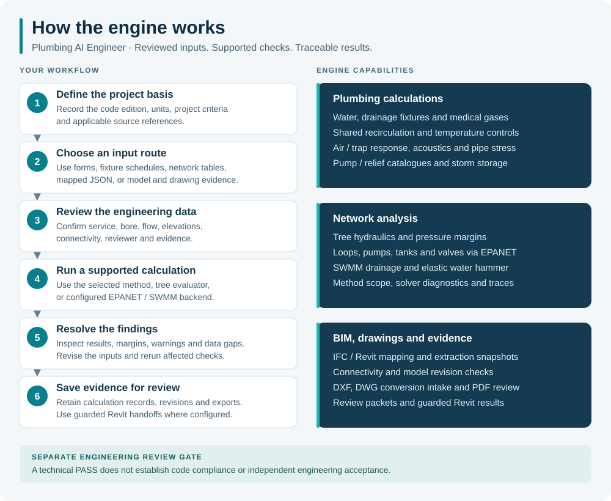

# Plumbing AI Engineer

**Plumbing calculations, hydraulic network analysis and BIM design review in one traceable workflow.**

A Python/SQLite engine with a Streamlit interface for plumbing engineers and BIM reviewers. Review project data, run supported calculations, and retain the sources, findings and revision history.

**Status: engineering review build.** Regression tests and EPANET comparisons are available. Independent engineering acceptance and a completed native Revit round trip remain pending. A technical **PASS** does not establish code compliance or approval.

Eight new **experimental research methods** start the coupled drainage, 3D frame/acoustic, tank draw/TMV, AGSS, liquid-source, commissioning-evidence and pressure-zone work. Signed-source verification is also available. See the [research workflow and validation boundaries](docs/COUPLED_RESEARCH.md).

[Open the local app](http://localhost:8504/) · [Quick start](#quick-start) · [Capabilities](#capabilities) · [Detailed guides](#detailed-guides)

## How it works



The engine separates **source facts**, **engineering inputs**, **results** and **approval status**. Results retain references and unresolved checks. Recalculate after input, source or design-basis changes.

## Capabilities

| Area | Available tools |
| --- | --- |
| **Water and fixtures** | Fixture schedules, demand calculations, supported pipe sizing, velocity and fixture minimum-size checks. |
| **Hot water and equipment** | Demand, heaters, shared-pipe recirculation and controls; experimental stratified storage, fixture draws/TMV behavior; pump/system curves and manufacturer CSV import. |
| **Drainage and stormwater** | IPC 2024 fixture-load register; DFU/slope/vent checks; Manning and SWMM liquid networks; air/trap checks; experimental conservative liquid/air/dilute-solids coupling. |
| **Pressure networks** | Tree hydraulics; EPANET 2.2 loops, pumps, tanks, valves, pressure-dependent demand, extended-period simulation and scenarios. |
| **Medical gas and vacuum** | Clinical demand, isothermal tree pressure, plant N+1/reserve; separate HTM / Saudi SBC-NFPA / ISO bases; experimental AGSS interfaces, liquid-source inventory and commissioning/quality-evidence audits. |
| **Physical effects and safety equipment** | Elastic water hammer, airborne acoustics, stress/expansion and relief checks; experimental 3D frame flexibility and structure-borne path response. |
| **Source and pressure-service review** | Detached source signatures with independently enrolled trust keys; model-matched zone pressure, control-boundary and PDA delivery audits. |
| **Models and drawings** | IFC/Revit mapping, physical-port diagnostics, snapshots and revision comparison; DXF, DWG conversion intake and PDF review. |
| **Sheets and evidence** | Interactive workbook forms, saved calculations, QA/QC, evidence packets, revision history and guarded Revit result handoffs. |

Each scoped tool states its source requirements, validation status and unevaluated checks. See the [extended methods and medical-gas guide](docs/ADVANCED_PLUMBING.md) for the new workflows and [original method guide](docs/PLUMBING_ENGINEERING_MODULES.md) for the baseline tools. All bundled examples are fictional.

## Use the engine

1. **Define the project.** Set code edition, jurisdiction, units, criteria and references in **Code Profiles / Design Basis**. IPC 2024 is the first verification target.
2. **Choose a workspace.** Use calculation pages / **Engineering Modules**, **Network Review**, **Calculation Sheets**, **CAD / IFC Checks**, or **Revit Exchange**.
3. **Review inputs.** Confirm service, bore, flow, elevations, connectivity, reviewer and evidence. Nominal diameter does not substitute for internal bore.
4. **Run and revise.** Inspect results, margins, warnings and missing/unevaluated checks. Correct inputs and rerun.
5. **Save for review.** Use **Report / Export** and **Release Readiness** for evidence and acceptance gaps. Native Revit handoffs require configured bindings and preflight.

| Result label | Meaning |
| --- | --- |
| `PASS` / `FAIL` | The evaluated technical criterion is met / exceeded. |
| `MISSING_DATA` / `NOT_EVALUATED` | Required data or supported evaluation is unavailable. |
| `REVIEW_REQUIRED` | Engineering acceptance remains outstanding. |

## Quick start

Use **Python 3.12** from the repository root:

```bash
git clone https://github.com/Ah2022/Plumbing-AI-Engineer.git
cd Plumbing-AI-Engineer
python -m venv .venv
# Windows: .venv\Scripts\activate
# macOS / Linux: source .venv/bin/activate
python -m pip install -r requirements.txt
# Optional SWMM dynamic-wave drainage backend:
python -m pip install -r requirements-hydraulics.txt
python -m streamlit run app/streamlit_app.py --server.port 8504
```

Open [localhost:8504](http://localhost:8504/) on the computer running the app. It initializes a database on first use. Replace bundled synthetic examples with reviewed project data.

See [setup and data requirements](docs/SETUP.md) for parsers, private workbooks, calculation libraries, EPANET and database isolation. Private sources are excluded from public Git. No verified public deployment URL is provided.

## Current limits

- **Sources:** code editions, numeric tables, manufacturer data and project applicability require review.
- **Drainage:** the coupled prototype uses chambers/flooded links and dilute tracers. Annular/slug stack transitions, discrete solids/blockage and complete vent arrangements remain outside scope; failed continuity invalidates acceptance.
- **Medical gas:** adopted editions/clinical criteria need review. AGSS and liquid inventory are bounded prototypes; gas assays, patient-interface/plant certification and authorized commissioning require actual evidence.
- **Physical effects:** surge stops at vapour pressure. Linear frame/radiation prototypes exclude elbow ovalization, nonlinear supports, full building flanking paths, fatigue and certified code stress/relief design.
- **Hot water:** modeled temperatures/age/TMV response do not establish microbial safety or certified scald protection; measured validation and a project water-safety process remain required.
- **Trust and zones:** signed data needs independently enrolled issuer keys. EPANET 2.2 cannot represent heterogeneous zone PDA curves through its global demand parameters.
- **Drawings:** IFC requires explicit mapping; missing ports remain unevaluated. DWG needs conversion, PDF needs drawing review, and large models need partitions.
- **Revit:** live property reads and rollback probes do not establish a completed native extraction/write-back/re-extraction test.
- **Deployment:** trusted local use; public multi-user project access control is not implemented.

## Detailed guides

| Guide | Contents |
| --- | --- |
| [Setup and data](docs/SETUP.md) | Installation, optional dependencies, private workbooks and project databases. |
| [Engineering methods](docs/PLUMBING_ENGINEERING_MODULES.md) | Formulas, source requirements and boundaries for the scoped modules. |
| [Extended methods and medical gases](docs/ADVANCED_PLUMBING.md) | Shared recirculation, SWMM, air/trap response, gas bases, surge, acoustics, stress, relief and CSV workflows. |
| [Coupled research and source authentication](docs/COUPLED_RESEARCH.md) | Eight experimental methods, actual calculation boundaries, source-signature setup and pressure-zone treatment. |
| [Hydraulic solver](docs/GENERAL_HYDRAULIC_SOLVER.md) | EPANET setup, network inputs, scenarios and diagnostics. |
| [BIM ingestion](docs/BIM_INGESTION_PHASE4A.md) | IFC/Revit mapping, connectivity, snapshots and the native test procedure. |
| [Interactive calculations](docs/INTERACTIVE_CALCULATIONS.md) | Import and use converted calculation forms. |
| [DWG / PDF intake](docs/DWG_PDF_UPLOADS.md) | Drawing conversion and review workflow. |
| [Engineering validation](docs/ENGINEERING_VALIDATION.md) | Independent reference candidates and acceptance requirements. |
| [Reports and release review](docs/REVIEW_AND_RELEASE.md) | Provenance, evidence packets, revisions and guarded handoffs. |

GitHub Actions runs [public-checkout validation](.github/workflows/validation.yml). Full local tests require private sources and optional solver evidence. Native Revit acceptance requires its own execution record. Software tests do not grant engineering approval.

## License

[MIT](LICENSE). Referenced standards and third-party design/manufacturer data retain their own terms.
