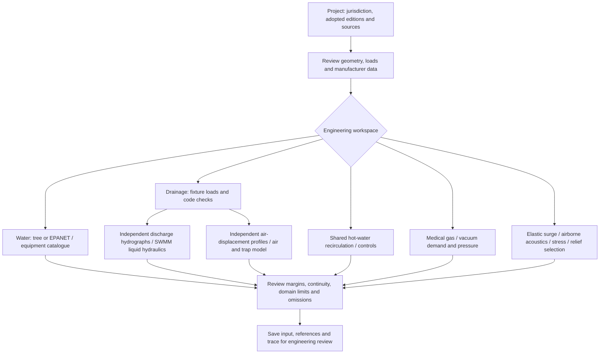

# Extended plumbing calculations and medical gases

Engineering review build. The added methods have synthetic analytical/regression checks; they have **not** been independently accepted for real-project design. The nominated BIM MANAGER review remains pending signed engineering evidence and applicable credentials. No numerical standard is adopted merely by selecting its title.

## Workflow



1. Open a project at [localhost:8504](http://localhost:8504/). Record its code edition, design basis and source revisions.
2. Open **Engineering Modules** and choose a method. Scope, source requirements, validation status and omissions appear before inputs. **Drainage & Vent** and **Hot Water** also provide shortcuts.
3. Replace the fictional example, including its source records. Use interactive tables, a JSON input package, or the manufacturer CSV templates where available. A source review assertion does not approve an output.
4. Calculate and inspect criteria, units, traces and charts. Failed continuity, nonconvergence or a validity-domain stop needs correction before acceptance. Run appropriate mesh/time-step sensitivity checks.
5. Download the package/findings or save an engineering review record. All new methods retain `REVIEW_REQUIRED` and code compliance `NOT_EVALUATED`.

## Medical-gas basis and calculations

The user's clarified references are represented by three separate choices:

| Choice | Record before design use |
| --- | --- |
| UK HTM 02-01 Part A | Adopted document edition/revision and exact clinical demand/diversity/pressure clauses. |
| Saudi SBC / NFPA 99 | Adopted Saudi provisions, NFPA edition, project HTM references if applicable, and written precedence. |
| ISO 7396-1 | Adopted edition/amendments, national/project criteria and exact source clauses. |

`HC 2020` was not established as an identifiable standard and is not a selectable alias. The [NHS publication](https://www.england.nhs.uk/publication/health-technical-memorandum-02-01-medical-gas-pipeline-systems/) and [ISO scope](https://www.iso.org/obp/ui?_escaped_fragment_=iso%3Astd%3Aiso%3A7396%3A-1%3Aed-3%3Av1%3Aen) identify distinct references. Project adoption, numerical demand tables and Saudi precedence still need confirmation. The example's adoption-pending text is intentional.

The engine sums supplied **clinical-position** demand groups: positions × reference L/min per position × diversity + continuous reference L/min. It does not equate terminal-unit counts with clinical positions or supply invented standard diversity defaults. All flow and plant/reserve quantities use the declared reference absolute pressure, temperature and compressibility.

For each pipe in a connected source-rooted tree, downstream demand is accumulated as mass flow. The constant-Z, isothermal low-Mach approximation is:

```text
rho_reference = p_reference / (R_specific * T_reference * Z_reference)
mass_flow = reference_flow * rho_reference
resistance_term = (f * L/D + K) * mass_flow² * R_specific * T * Z / area²
pressure service: p_downstream² = p_upstream² - resistance_term
vacuum service:   p_terminal² = p_plant_side² + resistance_term
```

Pressures are absolute. Vacuum input pipe orientation is plant → terminal while actual gas flow is toward the plant. Actual velocities use the lowest segment pressure. The output checks supplied terminal pressure ranges, velocity, a Mach limit no greater than 0.3, largest-available-unit-out plant capacity and usable reference-volume reserve duration. A nonpositive pressure square stops calculation with a bore/source/demand diagnostic.

This approximation neglects acceleration and elevation and uses supplied Darcy factors/gas properties. It does not simulate gas loops, choking, temperature-changing expansion, clinical gas quality, material/cleanliness, alarms, zone isolation or commissioning. AGSS and liquefiable N2O/CO2 services are rejected rather than treated as generic compressed gas. A source name or a passing pressure result cannot certify a medical-gas installation.

## Drainage fixture register and hydraulics

For an **IPC 2024** project, Drainage & Vent now presents 33 fixture/load variants covering the Table 709.1 categories, bathroom/kitchen groups, public/private WC variants, shower flow bands, emergency drains and indirect receptors. It includes the table's minimum-trap transcription and source/applicability notes. These are **FLAGGED transcription candidates**, not an authenticated adopted table. The [ICC 2024 Spanish table](https://codes.iccsafe.org/content/IPCSP2024P1/capitulo-7-drenaje-sanitario) was the accessible primary cross-check; the bidet trap transcription specifically needs English-edition/manufacturer review. Other codes/editions keep their own data; IPC is not substituted.

The register corrects discrepancies in the prior short workbook list, including residential washer 2 DFU and private 1.6-gpf WC 3 DFU. Existing saved rows retain their original references. New selections include the catalogue revision and conditions. Group/member overlap produces a warning; physical fixture identities still require review. Floor sinks have no invented fixed DFU and need an assessed connected load/evidence. Indirect discharge to a floor drain must be declared and assessed against its minimum. Special clear-water-only cases and fixtures beyond the table require separate source-backed assessment. Washer branch requirements, trap-arm/dry-vent/branch-interval checks and drain/sewer footnotes are separate from DFU summation.

**DFU is a code load, not L/s.** Existing DFU accumulation/sizing, slope, capacity, dry vent, trap arm and interval checks remain available. The new liquid solver accepts independently derived **L/s hydrographs**, real bores, invert elevations, Manning roughness, offsets/losses, junction depths, explicit minimum nodal storage area and free/fixed-head outfalls.

[EPA SWMM](https://www.epa.gov/water-research/storm-water-management-model-swmm) dynamic-wave routing handles liquid storage, backwater, surcharge, reverse flow and flooding in general connected layouts, including loops. This boundary currently exposes circular conduits, junctions and outfalls. Native code runs in an isolated process with a 45-second timeout; raw INP scripts and external file references are not accepted. Flooded water leaves this model; surface ponding and re-entry are not included.

The result reports signed liquid continuity error, flooding volume, sampled depth/flow/head/velocity/capacity traces and node nonconverged-step counts. A failed continuity/convergence criterion marks the result incomplete/failed. Statistics use the toolkit's converted SI volumes; output-series period indices are inclusive. Time-series peaks can be smaller than full-step peaks; reduce report/routing intervals as appropriate.

### Documented SWMM discrepancy

A 100 m, 100 mm, 1% slope pipe at a constant 2.582715 L/s reached the expected approximately half-full Manning state but the native SWMM 5.2.4 short-event continuity balance exceeded 12% for the tested dry-start/free-outfall boundary. The engine rejects that run even though all routing steps converged. The exact cause requires further native initialization/boundary investigation; it has **not** been waived or relabeled as valid. The ramp/plateau/drain-down reference has a near-zero balance residual and matches the Manning plateau within its stated tolerance. A successful event does not excuse another event's failed balance.

SWMM does not establish full building-stack annular liquid flow, solids transport or air-pressure compliance. **Drainage air network and trap response** adds a separate small-signal lumped model with supplied air-displacement hydrographs, polytropic volumes, linear vent resistances, open atmospheric paths and one-way AAV admission. It uses backward Euler with an AAV active-set solve, plus a forced equal-leg trap oscillator with supplied damping. It stops at a trap breach or the small-pressure domain limit. This is one-way pressure forcing, with no trap-displacement feedback, distributed stack acoustics, entrainment or liquid/air coupling. It is not a replacement for validated two-phase stack software or code vent sizing.

## Shared-pipe hot-water recirculation

Define directed closed circuits beginning/ending at an ideal fixed-temperature heater. Selected circuit flows accumulate in shared supply/return pipes. Every pipe's inventory, UA heat loss and hydraulic resistance is counted once. Mixed junctions conserve flowing energy; an upwind finite-volume model follows temperatures and ambient losses with a bounded stable timestep. A global energy residual is reported.

Choose continuous operation, an explicit schedule, or thermostatic hysteresis with a sensor node and separate on/off thresholds. Results include temperatures over time, low-temperature exposure, heater/ambient energy, pump-on time, circuit heads and additional balancing head. Shared trunks are included. Selected balanced flows remain prescribed; fixture draws, stratified tanks and variable valve/control hydraulics are not solved. Temperature and exposure flags do not certify hygiene, Legionella control or scald safety.

## Transients, acoustics, stress and relief

| Method | Added calculation | Remaining engineering boundary |
| --- | --- | --- |
| Elastic network water hammer | Interpolated method of characteristics; pipe wave travel, continuity junctions, fixed-head sources, valve flow-coefficient histories and Darcy friction. Input heads/flows must satisfy the steady state. | Stops at vapour pressure; no column separation, air pockets, pump inertia, unsteady friction or fluid-structure interaction. Grid/time convergence and real wave speeds need review. |
| Airborne acoustic prediction | Supplied band sound powers → direct/diffuse room transfer → attenuation → energetic source sum → supplied A-weight correction and receiver dBA. | No acoustic power inferred from velocity; structure-borne paths, near-field/coherent sources and cavitation noise remain outside scope. |
| Straight-pipe stress | Lamé pressure stresses, closed-end axial load, prescribed linear thermal restraint and bending; von Mises comparison and thermal anchor force. | No complete 3D piping flexibility, local support/elbow stress, fatigue, creep, external-pressure buckling or ASME B31 certification. |
| Relief catalogue checks | Supplied service/listing, set pressure/operating margin, matching capacity basis, capacity and temperature checks. | Certified ratings must come from manufacturer/listing evidence. Capacity bases are not interchangeable; discharge losses/backpressure, accumulation, sensing and installation remain unevaluated. |

The simple original screens remain separately available. The new acoustic/stress/surge methods do not change their numerical results. [KSB guidance](https://live-resources-e2e-sales.ksb.com/resource/blob/762108/b03ed4dd6aa0139a876090d66fe3b9f2/water-hammer-data.pdf), [ASHRAE's piping discussion](https://handbook.ashrae.org/Handbooks/S16/IP/s16_ch46/s16_ch46_ip.aspx), [ebm-papst acoustics](https://ebmpapst.se/sv/dat/media_manager/news/789/news-files/Brosch_Technologie_EN_screen.pdf) and [Watts relief guidance](https://www.watts.com/dfsmedia/0533dbba17714b1ab581ab07a4cbb521/24279-source/pg-tp-asme-pdf.pdf) provide method context, not project-specific approval.

## Manufacturer data and workbook usability

Pump/tank and relief tools now download/import small explicit SI CSV templates. Pump models and ordered H–Q points use separate files keyed by `model_id`. No extrapolation, automatic rating conversion or source authentication is performed. Every catalogue row must bind to a `MANUFACTURER` source (or an explicit synthetic demonstration). Package JSON retains the document/revision/page and original criteria. Real data, source pressures, bores and project demands cannot be replaced by plausible-looking generated values.

The safe workbook interpreter adds averages/counts, logical functions, IFERROR, conditional sums/counts, SUMPRODUCT, logarithms/powers, inverse trigonometry and ROUNDDOWN. IFERROR deliberately propagates **unsupported** formulas; it cannot turn an unevaluated calculation into an apparent success. Criteria ranges must have identical dimensions. Text-ordering criteria, array spills, macros, external workbooks and arbitrary Excel functions remain unsupported; no cached-output fallback is used.

## Install and validate

```bash
python -m pip install -r requirements.txt -r requirements-hydraulics.txt
python -m tools.validate_engineering
python -m pytest tests/test_engineering_modules.py tests/test_engineering_modules_ui.py tests/test_advanced_engineering.py tests/test_formula_extensions.py -q
```

The optional native toolkit is pinned to `swmm-toolkit==0.17.0`; the local executed engine reported SWMM `52004` (5.2.4). Examples and references contain fictional data only. Frozen references now include 41 author-prepared candidates; they are not signed independent engineering results. Existing tree/EPANET regression checks remain unchanged. Independent project references and documented source/engineering acceptance are required before any verified release.
