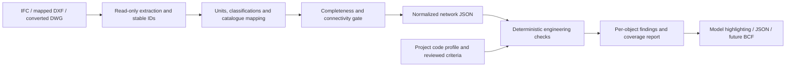

# CAD / IFC plumbing design-check study

**Research date:** 26 October 2026. **Recommendation:** add an IFC intake adapter first, then a mapped DXF adapter. Keep native DWG conversion as an explicit integration choice. Reuse the deterministic engine and code-governance workflow; do not make an image/LLM judgment the compliance decision.

This document records the 26 October feasibility study. **Update, 27 October:** the first [IFC/DXF intake and per-pipe design-check pilot](CAD_IFC_PILOT.md) is implemented and tested on real synthetic files. Full network mapping, interoperability with independently authored project models and blanket code certification remain pending. The Network Review page remains the calculation boundary for a future reviewed port-to-network adapter.

## What a model checker can establish

| Design question | Required model / project facts | Current engine boundary |
| --- | --- | --- |
| Are selected water pipes adequate? | Allocated cold/hot fixture loads or explicit terminal design flows, connectivity, actual internal bore, catalogue identity, material friction model, reviewed velocity/minimum-size criteria | Tree network demand, catalogue selection and velocity checks implemented |
| Is terminal pressure sufficient? | Source pressure under the stated operating flow, elevations, developed lengths, fitting coefficients, equipment losses at design flow, required outlet pressure | Every supported tree path and governing pressure margin implemented |
| Are gravity drainage loads and slopes adequate? | Drainage fixture units, flow direction, segment category, nominal-size mapping, invert elevations, horizontal runs and branch intervals | Cumulative DFU, context capacity, actual fall/slope and selected minimum criteria implemented |
| Is a vent adequate? | Vent type, connected drainage load, nominal designation in the source table's units, developed length, stack designation, trap-arm geometry | Supported dry-vent size/length and trap-arm distance checks implemented; broader arrangements are partial |
| Is the entire model code-compliant? | Adopted edition/amendments, independently verified rules/tables and complete applicable model facts | Cannot be concluded from geometry or a subset of passing checks; unresolved checks remain explicit |

Pipe DN, outer diameter and internal bore are different facts. DN-to-NPS is a designation mapping, not simply mm divided by 25.4. A geometric cylinder or an IFC nominal diameter alone is insufficient to invent an internal diameter or material roughness. Missing pressure, flow, equipment or classification data must produce a missing-data/unevaluated result, not a pass.

## Intake options

### IFC: preferred first pilot

Use a locally pinned/tested IfcOpenShell version to read the original IFC, its stable object identities, systems and port relationships. Its documented system utilities expose element systems, ports and connections, while its port API distinguishes explicit connections and flow direction from implicit connectivity. The pilot should prefer explicit connectivity and flag undefined/bidirectional directions rather than guessing a directed tree. [IfcOpenShell system utilities](https://docs.ifcopenshell.org/autoapi/ifcopenshell/util/system/index.html), [port connectivity](https://docs.ifcopenshell.org/autoapi/ifcopenshell/api/system/connect_port/index.html).

Normalize project/property units explicitly: IfcOpenShell's unit utility provides the scale between IFC project units and SI. Preserve original values/units and the conversion record. Resolve element/representation placement consistently before calculating elevation differences and lengths; verify that extraction on rotated/nested placements matches independently measured examples. [Unit utilities](https://docs.ifcopenshell.org/autoapi/ifcopenshell/util/unit/index.html), [placement utilities](https://docs.ifcopenshell.org/autoapi/ifcopenshell/util/placement/index.html).

IFC class membership is a useful starting point, not proof of engineering classification. A fixture must be mapped to the adopted code's actual fixture/use/control classification; a generic equipment family must be identified before it becomes a pump, tank or backflow device. Preserve source GlobalId, model identity, property-set path and mapping/reviewer provenance. Do not infer system connectivity solely because shapes touch.

### DXF: viable with a reviewed drawing convention

Use ezdxf for DXF entities and embedded information. Its own documentation says it is an interface to DXF, not a CAD kernel or DWG converter. It points to ODA File Converter for DWG/DXF conversion. [ezdxf introduction](https://ezdxf.readthedocs.io/en/stable/introduction.html).

Define mappings for layers, blocks, attributes, line types, diameter labels, material schedules and system names. Preserve drawing identity, entity handle and block-instance context. Crossings on a plan must not automatically become pipe connections. Resolve insert transforms, referenced drawings and annotation units before using geometry. A 2D plan lacking invert levels, risers or fixture schedules cannot establish pressure balance or gravity fall; show those checks as unavailable until supplied.

### Native DWG / Autodesk integration

Choose either a reviewed local DWG-to-DXF export/conversion workflow or a licensed/native Autodesk integration. Autodesk Platform Services Model Derivative can expose design properties for supported translations; its metadata documentation cautions that some endpoint values contain units within strings. Translation/viewer data therefore still needs typed normalization and does not replace plumbing semantics. [Model Derivative](https://aps.autodesk.com/apis-and-services/model-derivative-api), [metadata extraction](https://aps.autodesk.com/blog/accessing-design-metadata-without-viewer).

Keep local processing the default for the pilot. An external translation service would be a separate deployment/data-transfer decision. No project model was sent to such a service in this work.

## Proposed pipeline

The extracted facts and engineer-reviewed mappings must remain separate. Each adapter should emit evidence for every normalized value: source file hash/model identity, element ID, property/geometry origin, original unit, converted value, mapping version, confidence and reviewer. Current JSON examples are synthetic contracts and not ready-made mappings for a real model.

The normalized model uses explicit `water_wsfu` and `drainage_dfu` fields, declared cold/hot service, source/outlet roots and directed connectivity. It never reuses drainage fixture units as water demand. Current engine limits are 500 nodes and 500 pipes per submitted tree, with one source/outlet and no loops. Larger/federated systems need explicit partition boundaries or a separately validated solver; silently truncating a model is unacceptable.

## Model-data readiness versus engineering compliance

Use an IDS to express the agreed information-delivery contract: required classifications, properties, units and values. buildingSMART describes IDS as a machine-readable exchange-requirements mechanism. IfcTester can validate IFC against IDS and generate reports, including JSON and BCF. This is well suited to the **data readiness** stage, not a substitute for hydraulic equations, topology-dependent rules or code applicability. [buildingSMART IDS](https://technical.buildingsmart.org/Projects/Information-Delivery-Specification-Ids/), [IfcTester](https://docs.ifcopenshell.org/ifctester.html).

The pilot contract should require at least:

- Stable model/object identity and source schema/version.
- System/service classification, explicit port/connectivity evidence and reviewed flow direction.
- Actual bore/catalogue mapping for water; correct nominal designation for table checks.
- Fixture classification and separate cold/hot WSFU and drainage DFU sources.
- Developed lengths, elevations/inverts, horizontal runs, material and fittings/equipment data.
- Source-pressure conditions, required outlet pressures, vent arrangement/length and trap information.
- Governing code edition, amendments, methods, project approvals and verified source references.

Source facts may be absent, contradictory or inferred. Report these separately. Inferred connections/classifications should be review suggestions and should not satisfy mandatory inputs until confirmed.

## Finding contract and review experience

Produce a per-object issue with `model_id`, source object ID, normalized network/pipe/node ID, check ID, adopted profile/revision, expected/selected/actual values and units, reference, technical status, review status, evidence confidence and explanation. Show which checks were run, unavailable or unsupported. Maintain model revision and result invalidation exactly as the engine already does for governed calculation contexts.

A viewer can highlight affected objects and navigate to their IDs. JSON is the first integration target; BCF is a useful later issue-exchange target. IfcTester's documented BCF reporter is evidence that data-readiness findings can be exported that way; engineering findings will need their own reviewed object/viewpoint mapping rather than assuming the IDS reporter already implements our calculations. [IfcTester report formats](https://docs.ifcopenshell.org/ifctester.html).

## Concrete pilot and acceptance evidence

Start with one IFC export containing a small cold-water tree and a drainage/vent example whose expected results have been checked independently. Establish the delivery/mapping contract, then extract read-only facts and list gaps. Compare normalized IDs, units, connectivity, bore/nominal mappings, elevations and lengths against the original authoring model. Run the same normalized network through the existing engine and compare the results with the hand-check pack.

Include missing ports, undefined flow direction, swapped WSFU/DFU, DN/NPS ambiguity, missing bore, disconnected branches, reversed fall, oversized/undersized selections, insufficient pressure, unsupported wet venting and model-revision changes as negative cases. An incomplete model must remain incomplete. Repeat on a second independently authored IFC and a mapped DXF before claiming adapter interoperability. Native DWG conversion and cloud viewing need separate validation.

The key dependency is the quality of the source model and approved engineering reference pack, not an AI vision model. This pilot cannot establish blanket IPC/SBC/Egyptian compliance while applicable rule/table verification remains pending.
