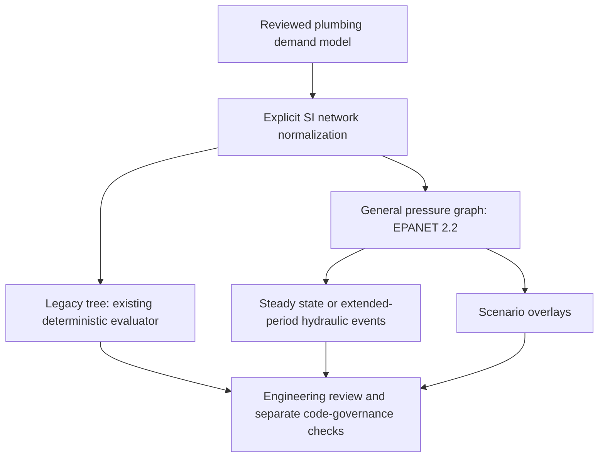

# Phase 2 A: general hydraulic solver boundary

The existing `calculations/network.py` tree evaluator is unchanged. Legacy tree inputs route to that evaluator and return its original result inside `result`. General pressure-network inputs route to an isolated **EPANET 2.2** worker. Loops and closed-link legacy models cannot silently run through the tree evaluator.



## Use it in the engine

Open [the local app](http://localhost:8504/), select a project, then **Network Review → General pressure network**.

1. Choose a looped network, a pressure-dependent-demand case or a 24-hour pump/tank/valve example. All bundled inputs are synthetic and require project/manufacturer review before design use.
2. Edit the junction/source/tank and pipe/pump/valve tables, or upload/make mapped graph JSON. Enter **actual internal bores**, elevations, hydraulic boundary heads, referenced demands and manufacturer H-Q curves. Simulation controls and advanced equipment definitions are available in their expander. The diagram shows topology and declared orientation; simulated flow may reverse.
3. Choose duration/timesteps and DDA/PDA parameters. PDA explicitly needs minimum pressure, full-delivery pressure, exponent and reference. Individual junction pressure requirements remain separate from the global PDA delivery relation.
4. **Run general hydraulic simulation**. Inspect solver completion, pressure/demand criteria, timestamped node pressure, requested/delivered flow, unmet demand, tank level/volume and link flow/status. Source heads are absolute hydraulic grades. `boundary_pressure_head_m` is measured at the source's declared elevation; EPANET reservoir-surface pressure is not presented as plumbing inlet pressure.
5. **Run declared scenario analysis** to compare peak demand, minimum source head, added fire demand, low/high tank levels, pump failure and valve closure. Every scenario retains its explicit overlay and results. Unavailable links remain closed throughout the run: their reopening controls are disabled and recorded. Fire load is a separate unpatterned demand category; a low domestic pattern cannot reduce it.
6. Download normalized JSON, EPANET INP, full hydraulic findings and scenario findings. Saving a review retains the normalized model, input fingerprint, solver provenance, diagnostics and complete time series in the project. Changed input suppresses earlier findings until rerun. Saving is an explicit action.
7. **Compare the existing tree evaluator** runs all five Phase 1 A water envelopes through both boundaries. It exposes unmodified tree pressure, raw EPANET pressure and the residual after reconciling published equation conventions.

## Configure EPANET

The app does not download or execute user-uploaded solver binaries. Configure the server with a trusted **EPANET 2.2** native library (toolkit version **20200**). For Windows, the official OWA package contains `64bit/epanet2.dll`. Set the environment variable before starting Streamlit:

```powershell
$env:PLUMBING_EPANET_LIBRARY = 'C:/trusted/EPANET/64bit/epanet2.dll'
python -m streamlit run app/streamlit_app.py --server.port 8504
```

`EPANET_LIBRARY` is accepted as a fallback for validation/CI. On Linux/macOS provide the compatible 2.2 shared library built from official source. The ctypes adapter uses the platform's native loader. Local live acceptance was performed with the official Windows 64-bit library; other platforms require their own live-library acceptance. A public/Cloud checkout without the native library still opens the interface, validates/exports models and runs the original tree layer. General simulation then reports **BACKEND_UNAVAILABLE** with setup instructions; it does not substitute tree results.

Use the [official EPA EPANET page](https://www.epa.gov/water-research/epanet), [OWA 2.2 release](https://github.com/OpenWaterAnalytics/EPANET/releases/tag/v2.2), [toolkit API](https://github.com/OpenWaterAnalytics/EPANET/blob/v2.2/include/epanet2_2.h) and [build instructions](https://github.com/OpenWaterAnalytics/EPANET/blob/v2.2/BUILDING.md). Existing pinned download/library checksums are in `validation/phase1a/epanet-provenance.json`. CI verifies the official archive checksum before its Windows live run.

## Normalized contract

Inputs use `schema_version: pressure-network-1`, `units: SI`, the project `code_id`, a `basis_reference`, and the following fields. See `examples/pressure_loop.json`, `pressure_pda.json` and `pressure_eps.json` for complete executable inputs.

| Object | Required engineering data |
| --- | --- |
| Junction | ID, elevation m, demand L/s, required pressure head m, demand/source references; optional demand-pattern ID and separate fire demand L/s |
| Source | ID, elevation m, **absolute hydraulic grade** `head_m`, reference; available pressure head at the boundary is head minus elevation |
| Tank | ID, bottom elevation m, min/initial/max level m, diameter m and source reference; cylindrical geometry and EPANET minimum-volume convention |
| Pipe | IDs/endpoints, length m, **internal diameter mm**, roughness with explicit unit, local-loss K, initial OPEN/CLOSED status, reference |
| Pump | IDs/endpoints, referenced H-Q curve, relative speed, OPEN/CLOSED status, source reference |
| Valve | IDs/endpoints, bore mm, PRV/PSV/PBV/FCV/TCV type, setting and setting unit, local-loss K, reference |
| Pump curve | At least three explicit increasing-flow/decreasing-head points, L/s and m, source reference; no invented duty-to-curve conversion |
| Pattern | Named list of nonnegative dimensionless multipliers; explicit pattern timestep |
| Control | Target link, OPEN/CLOSED action, referenced elapsed-time condition (seconds) or tank-level/junction-pressure ABOVE/BELOW threshold (m) |
| Scenario | ID, label, reference, optional base-demand multiplier, source-head overrides, extra fire demands, initial tank-level overrides and unavailable-link IDs |

The simulation uses explicit `H-W`, `D-W` or `C-M` friction equations. Pipe roughness units must respectively be `C`, `mm` (absolute roughness) or `s/m^(1/3)` (Manning n). Generic `roughness` is never reinterpreted across equations. Water properties use EPANET's standard water defaults; no custom-fluid/temperature correction is claimed. Demand pattern timing starts at zero and repeats. EPANET's `min_volume_m3=0` uses its default tank geometry/minimum-volume convention; inspect the reported volume and levels rather than interpreting it as a zero-volume tank at a positive minimum level.

Valve PRV/PSV/PBV settings use m pressure/head; FCV uses L/s; TCV uses dimensionless K. Unsupported GPV curves, arbitrary rule scripts, clock-time controls, variable-speed schedules and nonlinear tank-volume curves are rejected or outside this contract. Supported pump controls restore the declared relative speed when reopening: EPANET's generic `OPEN` command would reset speed to1, so it is deliberately serialized as the explicit speed setting.

The legacy-to-EPANET adapter supports explicit terminal-flow H-W networks with selected catalogue bores. It refuses unresolved WSFU demand, constant Darcy-f-to-roughness conversion and fixed equipment losses that lack an explicit equivalent valve/curve. They are not silently dropped. New general graphs always use the general backend, even when their topology happens to be a tree. Automatic catalogue sizing remains in the building-tree layer.

## Solver completion and diagnostics

The parent validates the model before launching a separate native worker. A run has a 45-second default timeout (maximum60), bounded output and hydraulic-event limits. Native crashes, timeout, an absent/incompatible toolkit, invalid model, unbalanced/unstable iterations and incomplete periods cannot produce a successful completed result. Failure cases carry an actionable diagnostic and, where available, the EPANET report excerpt and preceding hydraulic snapshots.

Limits are 500 nodes, 1,000 links, 100 controls, 100 curves/patterns, seven days per run, at least60 seconds for configured hydraulic/pattern timesteps, and at most10 scenario overlays. Event-driven steps may be shorter than the configured hydraulic step when controls or tank limits trigger. Results are sampled at every returned hydraulic event, including the final requested time; they are not a claimed continuous transient solution.

`CONVERGED` means the requested hydraulic period completed. Pressure/demand criteria are separately `PASS`, `FAIL` or `WARNING`. Convergence can coexist with inadequate pressure, unmet PDA demand, pump-curve/valve warnings or forced DDA flow at negative pressure. Unbalanced/unstable warnings stop acceptance of that run. Other EPANET warnings retain their diagnostic rather than disappearing behind a technical PASS. For inadequate service, inspect the affected time/node pressures and deficits, then review source head, pressure zones, bore/resistance, pump curves and controls.

## Code governance and acceptance

Every general-backend result and scenario retains **`REVIEW_REQUIRED`** and **`code_compliance_status: NOT_EVALUATED`**. A successful numerical solve cannot approve IPC, SBC, another code or a fire-demand design. The saved calculation retains this review requirement even when project adoption has been approved. Reports label general-backend coverage **PARTIAL**. Applicable code sources, fixture diversity, velocity/minimum-size rules, complete mapping and independent engineering review require separate evidence.

No solver output automatically changes pipe sizes, a Revit model or an adopting authority's decision. Hydraulic nodal demands are supplied by the reviewed plumbing demand model; this general solver does not infer them from fixture counts or occupancy. Pump curves establish modeled H-Q behavior; manufacturer efficiency, NPSH, motor/energy selection and real equipment acceptance remain outside that result. Thermal recirculation, transients, gravity drainage and water-quality analysis are not implemented by this boundary.

## Validation

The existing tree goldens continue to pass with **exactly unchanged result dictionaries**. Five equivalent water trees are also run through the new backend. Their small raw pressure differences are exposed and reconciled against published EPANET2.2 H-W exponent/conversion/minor-loss conventions; unexplained residuals fail the comparison. No tree value is adjusted to force agreement. The Phase 1 A independent worksheet/EPANET adapter is kept separate from production code.

New actual-library tests cover symmetric loop flow and pressure against a hand balance, a PDA pressure/flow equation solved independently, pump curve points and speed affinity, PRV/PSV/PBV/FCV regulation, all three friction equations, tank storage continuity, elapsed pump controls, seven scenario types, held pump failure, unpatterned fire demand and deliberate hydraulic nonconvergence. Native-worker failure/timeout, missing backend, input errors, unsafe legacy routing, stale UI findings and forced engineering-review status are tested separately.

Storage conservation reconciles EPANET2.2's rounded **28.317 L/cuft** flow conversion with geometric volume conversion **0.3048³ m³/cuft**. This accounts for the roughly5.4ppm difference between raw L/s integration and geometric volume; tests use the published conversion equation rather than expanding a conservation tolerance. Reference sources are [`types.h`](https://github.com/OpenWaterAnalytics/EPANET/blob/v2.2/src/types.h), [`epanet.c`](https://github.com/OpenWaterAnalytics/EPANET/blob/v2.2/src/epanet.c) and the [EPA manual](https://nepis.epa.gov/Exe/ZyPURL.cgi?Dockey=P10113EM.TXT).

An active FCV in EPANET2.2 uses finite conductance `1/CBIG`, where `CBIG=1e8`. In the feasible2L/s regulation test, the exposed residual is approximately0.0000371L/s. It is reconciled to `head_drop_ft * 28.317 / 1e8` within1e-10L/s, rather than hidden by rounding the reported flow or widening a setting tolerance. See [`fcvcoeff` in hydcoeffs.c](https://github.com/OpenWaterAnalytics/EPANET/blob/v2.2/src/hydcoeffs.c). Valve outputs retain configured settings/units and FCV flow-setting residuals. Link status follows the toolkit's binary flow-enabled/closed status and does not, by itself, distinguish regulating from fully open valve operation. These convention explanations still require engineering review.

```powershell
# Pure graph/interface/failure checks; live tests skip if no toolkit is configured.
python -m pytest tests/test_general_solver.py tests/test_general_solver_ui.py -q

# Actual local backend and complete source/result trace.
python -m tools.hydraulic_solver examples/pressure_loop.json --output outputs/loop.json
python -m tools.hydraulic_solver examples/pressure_eps.json --scenarios --output outputs/scenarios.json
python -m tools.hydraulic_solver examples/water_network.json --compare-tree --output outputs/comparison.json
```

The examples and functional tests do not supply independent real-project engineering acceptance. Phase 1 A review gaps remain open, and the new backend's engineering scope still requires independent reviewed reference designs. No release is labeled verified from these software tests.
